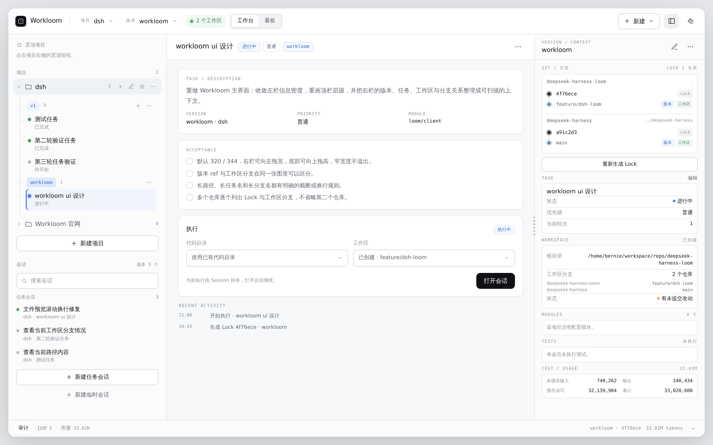

# Workloom（织）

[](https://www.npmjs.com/package/dsh-workloom)
[](https://github.com/zhengyanxiong/dsh-workloom/actions/workflows/ci.yml)
[](LICENSE)

**Workloom 是 DeepSeek Harness 的多项目工作台插件。** 它把项目、版本、Lock、任务、Git 工作区和原生 Agent 会话组织到同一个界面里，让多个仓库的并行开发不再依赖临时脚本和手工切换目录。

Workloom 复用 DSH 原生的会话、Diff、输入框、模型选择、审批、工具和权限体系；它不替代 DSH，也不修改你的 DSH 安装。

[English](#english) · [更新日志](CHANGELOG.md) · [待办](TODO.md) · [设计笔记](design/workloom-ui-design.md)



## 它能做什么

- **多项目管理**：一个工作台管理多个项目，每个项目可以包含多个本地 Git 仓库和业务模块。
- **版本与 Lock**：版本记录每个仓库的分支、标签或提交；生成 Lock 时固定到精确 commit，之后所有任务都基于同一份不可变基线。
- **任务与工作区**：项目拥有可复用的工作区池；任务可以从 Lock 新建 managed / direct / linked 工作区，也可以复用池中已有目录，并支持跨版本显式接管。
- **原生 Agent 会话**：在任务工作区内启动 DSH 原生会话，继续使用原生工具、审批、模型选择和上下文压缩。
- **原生预览**：Markdown、图片和代码在面板内按原生渲染，Diff 树按目录逐层展开，不再一次性读入全部改动。
- **Diff 与验收**：对照 Lock 查看工作区改动、未跟踪文件、未推送提交，并按任务状态流转。
- **执行权**：同一工作区同时只允许一个 Agent 执行；只有实际占用工作区的 Session 会阻止开始，任务状态本身不会；支持等待、显式接管和释放。
- **审计与用量**：Activity 面板记录项目、版本、任务、Lock、工作区和执行操作；Usage 面板展示 DSH 原生 token 统计。
- **可编辑**：项目、版本、任务创建后可以继续修改；编辑会保留内部 repository/module id，避免旧版本、Lock 和任务失联。

## 安装

从 npm 安装：

```bash
dsh plugin --profile web add dsh-workloom@0.1.7
dsh --profile web
```

Desktop：

```bash
dsh plugin --profile desktop add dsh-workloom@0.1.7
```

然后重启 DSH。Web 端仅刷新浏览器不够，Host 和 Client 都需要重新加载插件。

要求：DeepSeek Harness `>=0.2.1-rc.2 <0.3.0`，Node.js `>=22.19`。

> 本机如果配置了只读镜像（例如 `registry.npmmirror.com`），镜像可能尚未同步新版本。安装时临时使用官方 registry：
>
> ```bash
> npm_config_registry=https://registry.npmjs.org dsh plugin --profile web add dsh-workloom@0.1.7
> ```

## 快速开始

1. **新建项目**：填写项目名，添加一个或多个本地 Git 仓库；仓库使用绝对路径，工作区相对目录不能重叠。
2. **新建版本**：为每个仓库填写分支、标签或 commit。Workloom 不会自动 fetch，ref 必须已经在本地存在。
3. **生成 Lock**：把版本 ref 解析成精确 commit。如果 Git 无法读取仓库，界面会显示具体路径和 Git 的错误信息。
4. **新建任务**：选择版本、优先级和涉及模块，描述这次要完成的工作。
5. **开始执行**：选择工作区模式（复用池、managed、direct、linked），Workloom 启动原生 Session 并登记执行权。
6. **查看 Diff、验收、清理**：Diff 以本次 Attempt 启动时的 HEAD 为基线；复用前必须提交工作区改动，清理会二次确认。

## 核心概念

| 概念 | 含义 |
| --- | --- |
| Project | 一个业务项目和它包含的本地 Git 仓库、模块 |
| Version | 每个仓库的一组 ref，表示一个待开发版本 |
| Lock | Version ref 解析后的精确 commit 集合，不可变 |
| Task | 在某个 Version 上执行的一项工作 |
| Workspace | 从 Lock 物化出来的工作区，可跨 Session 复用 |
| Attempt | 任务的一轮执行，记录 Session、工作区和状态 |
| Execution | 当前工作区的执行所有权，含 FIFO 等待和交接 |

## 兼容性与限制

- 当前只支持本地 Git 仓库；不支持远程 clone、Git URL 或跨机器工作区。
- Lock 创建时如果本地没有对应 ref，会从默认远端（优先 `origin`）执行一次 `git fetch --no-tags <remote> <ref>`，再解析 `FETCH_HEAD`；失败时保留 Git 错误。
- Git 调用会禁用用户级和系统级配置及 hooks，但会为当前仓库路径显式传入 `safe.directory`，以兼容 Windows 或不同账户下的目录所有者检查。
- `direct` 直接使用真实目录，Loom 只登记和执行，不复制、不移动、不删除；`linked` 由 Loom 创建容器和链接，清理只删除容器，不删除真实仓库；`managed` 由 Loom 创建 worktree 和根目录，清理会删除这两者。
- `linked` 会话会以 DSH `danger-full-access` 运行，因为链接目标位于工作区根目录之外；`managed` 与 `direct` 使用 `workspace-write`。
- 项目技能完全交给 DSH 原生会话技能目录：单仓库直接读取工作区根目录的 `.dsh/skills` / `.agents/skills`；多仓库容器在根目录聚合各仓库的技能条目并随任务启动刷新，Agent 在会话中用原生 `skill` 工具按需加载，Loom 不再维护一套平行的技能浏览/注入 UI。
- Workloom 的执行权只约束 DSH 托管的 Agent 调用；外部编辑器和终端仍可修改工作区文件。
- 终止确认观察的是 Agent 状态，不是所有子进程或外部进程。
- Terminal、测试面板尚未接入原生或外部数据源。
- 当前为早期预览版本，接口和数据格式仍可能变化；升级前请备份 `$DSH_HOME/loom`。

## 历史数据迁移

旧版 catalog（`schema: loom-json-store` 且 `version: 1`）只保存工作区 `path`、`managed` 和版本 `source.path`。新版加载时会自动补出 `projectId / mode / rootPath / rootOwner / repositories`；显式迁移脚本会把文件写成 `version: 2`，并先备份原文件：

```bash
# 原地更新并生成 catalog.json.v1-<时间戳>.bak
pnpm run migrate-catalog -- --file "$DSH_HOME/loom/catalog.json"

# 或写到另一个文件，先对比再替换
pnpm run migrate-catalog -- --file "$DSH_HOME/loom/catalog.json" --output /tmp/catalog.v2.json

# Windows PowerShell
pnpm run migrate-catalog -- --file "$env:DSH_HOME\loom\catalog.json"
```

迁移只改 catalog，不移动、不删除任何用户目录，也不改 DSH Session 文件。`managed` 工作区迁移为 `managed/worktree/rootOwner=loom`；其他旧工作区迁移为 `direct/direct/rootOwner=user`。旧 direct 工作区的 `path` 如果正好等于仓库根目录，迁移会把绑定放回 `.`，避免多出一层目录。如果旧项目把仓库根目录写成了工作区的子目录，请迁移后在项目的“工作区相对目录”里改成 `.`，或改用 `direct` 选择真实仓库根目录。建议迁移前备份整个 `$DSH_HOME/loom`。

## 开发

```bash
pnpm install
pnpm run typecheck   # Host / Client / domain 三个程序
pnpm test            # 单元测试
pnpm run build       # tsdown 打包到 lib/
node scripts/stage.mjs <DSH 源码检出目录>   # 把本地产物装进一个 DSH 检出
```

TypeScript 源码在 `src/`，构建产物在 `lib/`，不要手工编辑 `lib/`。其中 `lib/typert.*` 由 Host FaceModel 生成并随仓库提交（生成器需要 DSH 源码检出才能分析工作区，见 [CONTRIBUTING](CONTRIBUTING.md#generated-artifacts)）。

## 贡献

欢迎提交 Issue 和 Pull Request。开始之前请阅读 [CONTRIBUTING](CONTRIBUTING.md)、[行为准则](CODE_OF_CONDUCT.md) 和 [安全策略](SECURITY.md)。

## 许可证

[MIT](LICENSE)

## English

**Workloom is a multi-project workbench for DeepSeek Harness.** It organizes projects, Git-backed versions, immutable Locks, tasks, isolated workspaces and native Agent sessions in one workbench, reusing DSH's native conversation, Diff, composer, model, approval, tool and permission surfaces.

Highlights:

- Multiple projects, repositories and business modules in one workbench.
- A version pins refs per repository; a Lock resolves them to exact commits.
- A project owns a reusable workspace pool; tasks create managed, direct or linked workspaces or reuse an existing one, with explicit cross-version takeover.
- Native DSH Sessions run inside a task workspace with the usual tools and approvals; linked workspaces run with full file access because their links target real repositories outside the container.
- Native file previews (Markdown, images, code) and a diff tree that reads one directory level at a time.
- Workspace ownership allows one Agent at a time, with waiting, takeover and release.
- Durable audit history and native token usage reporting.
- Projects, versions and tasks remain editable after creation.

Requirements: DSH `>=0.2.1-rc.2 <0.3.0`, Node.js `>=22.19`.

```bash
dsh plugin --profile web add dsh-workloom@0.1.7
dsh --profile web
```

Development:

```bash
pnpm install
pnpm run typecheck
pnpm test
pnpm run build
```

Workloom currently supports local Git repositories only and remains an early preview. Lock creation fetches a missing ref from the default remote once, then resolves `FETCH_HEAD`.

## License

[MIT](LICENSE)
